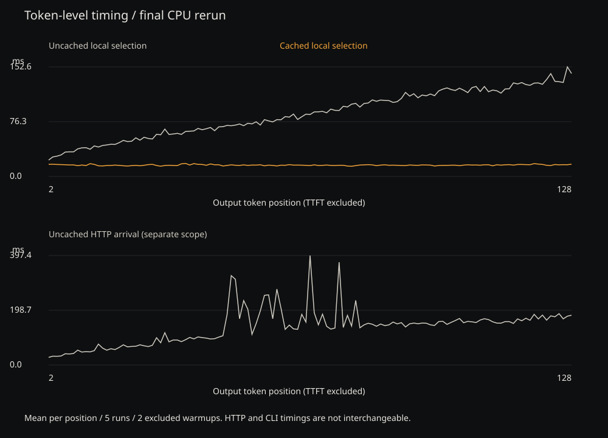
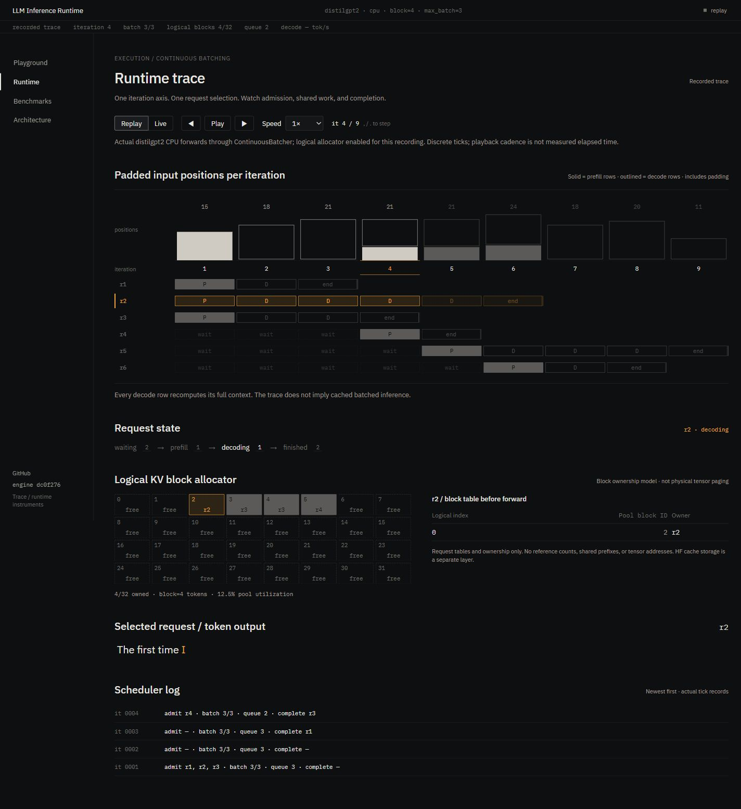

# LLM Inference Runtime

An LLM inference runtime built from first principles to explore and implement autoregressive decoding, KV caching, batching, scheduling, streaming, and inference optimizations.

The project makes token generation and request execution inspectable: explicit model forwards, visible state transitions, correctness checks, and raw benchmark measurements. Inspired by vLLM, TGI, and llama.cpp, it is not a replacement for those engines. **M0–M17 are complete.** No `model.generate()` or another inference engine's decoding API is used.

Single-request KV reuse avoids repeated input-position work with verified identical token IDs. Final token-level measurements and raw evidence are described below. INT8 reduced estimated weight payload but changed the continuation; speculative decoding preserved greedy output but was slower. Negative results are retained. Historical M7/M13 timing may be affected by host contention; that explanation remains a hypothesis, not an established cause.

## Implemented capabilities

| Capability | Implementation |
| --- | --- |
| Hugging Face model/tokenizer loading and logits inspection | `model_loader.py`, `forward_inspect.py` |
| Manual greedy and temperature/top-k/top-p sampling | `greedy_decode.py`, `sampling.py`, `sample_decode.py` |
| Request-local HF KV reuse and paired measurements | `cached_decode.py`, `benchmark_cache.py` |
| Lifecycle, FIFO admission and round-robin execution | `request.py`, `scheduler.py` |
| Real static/continuous multi-row greedy batching | `batching.py`, `continuous_batcher.py` |
| Shared-model HTTP and live SSE tokens | `server.py`, `benchmark_server.py` |
| Logical fixed-block capacity, ownership and reuse | `block_allocator.py` |
| Native CPU INT8 and explicit greedy draft/verify | `benchmark_quantization.py`, `speculative_decode.py` |

These mechanisms are not all fused into one production engine.

## Architecture

```text
HTTP request -> worker command queue -> FIFO continuous admission
  -> changing active batch -> tokenize once; pad full contexts
  -> uncached multi-row forward -> per-row argmax -> state update
  -> live token SSE -> next tick -> completion and resource release

Separate cached path:
cached decoder / DecodeScheduler -> full-prompt prefill
  -> request-local HF DynamicCache -> newest-token forwards
  -> argmax -> state update -> completion releases cache
```

The **HTTP batching path is uncached**; it does not combine variable-length HF caches. Optional blocks track logical capacity, not physical tensor storage. See [architecture](docs/architecture.md) for complete data paths and [postmortem](docs/postmortem.md) for tradeoffs/results.

## Setup

Python 3.11+ is required. Tested on Windows with Python 3.11.9, PyTorch 2.14.0+cpu, Transformers 5.17.0, and four PyTorch threads. Representative results are CPU-only, not validated CUDA claims.

```powershell
python -m venv .venv
.venv\Scripts\Activate.ps1
python -m pip install --upgrade pip
python -m pip install -e ".[server,test]"
python -m pytest -q
```

Linux/macOS activation: `source .venv/bin/activate`. Base dependencies: torch for tensor/model execution, transformers for models/tokenizers. Test extras add pytest/HTTPX; server extras add FastAPI/Uvicorn/HTTPX. M14–M17 add no dependencies. Version bounds are not a lockfile; record exact versions/thread count/machine conditions when rerunning.

Real commands download weights into the normal Hugging Face cache, not the repository. First-run disk/time costs may be substantial. Unauthenticated Hub and Windows symlink warnings do not invalidate successful runs. Explicit unavailable CUDA requests fail; use CPU to reproduce these experiments.

## Inspect a model and forward pass

```powershell
python -m llm_runtime.model_loader distilgpt2 --device cpu
python -m llm_runtime.forward_inspect --device cpu --prompt "The capital of France is"
```

The inspection reports token pieces/IDs, tensor shapes, logits and top-five final-position candidates without generating a continuation. Default model: `distilgpt2`.

## Manual decoding

```powershell
python -m llm_runtime.greedy_decode --device cpu --prompt "The capital of France is" --max-new-tokens 10
```

Tokenize once into `[1,T]`; forward to `[1,T,V]` logits; select final-position argmax; append token/extend mask; repeat until EOS or budget. Zero-token requests perform no forwards. This reference path uses `use_cache=False`, recomputing the full growing sequence. Results include IDs/text and forward-length traces.

## Sampling

```powershell
python -m llm_runtime.sample_decode --device cpu --temperature 0.8 --top-k 40 --top-p 0.95 --seed 42 --max-new-tokens 10
```

Selection is `logits -> temperature -> top-k -> top-p -> softmax -> multinomial`. Temperature must be positive/finite; zero is invalid (use greedy). Optional top-k retains exactly k candidates, clamped to vocabulary; optional top-p retains the cumulative-threshold crossing token. A seed initializes a local device-specific `torch.Generator`, not global randomness; cross-version/device reproducibility is not promised. Sampling remains uncached and is not exposed by HTTP.

## KV caching

```powershell
python -m llm_runtime.cached_decode --device cpu --max-new-tokens 10
```

Prefill forwards the full prompt with `use_cache=True`, stores returned `past_key_values`, then forwards only the newest token with that cache. Retain each returned cache; keep the full logical attention mask. State is request-local. In the inspected GPT-2 API, `DynamicCache.get_seq_length()` supplies ordinary unpadded position offsets. Distilgpt2 returned six layers with K/V shape `[1,12,5,64]` after the five-token prompt.

Caching avoids earlier projection recomputation, not all attention work: prior K/V is still read and cache memory grows. Prefill remains, so a major TTFT improvement is not promised. The last selected token need not enter the cache when generation finishes.

## Request lifecycle and scheduling

`RequestState`: `WAITING -> PREFILL -> DECODING -> FINISHED`, with selected IDs, execution count, runtime inputs/cache and stop reason. EOS, budget, zero-token, cancellation and error completion are explicit. Completion clears runtime tensors/cache; exported results contain small token/text data.

`DecodeScheduler.add_request/step/run_until_complete` admits FIFO up to `max_active` and advances independently cached requests round-robin. One step advances **one request**, not a batch. Scheduling decides who runs; batching decides who shares a forward. This scheduler is separate from HTTP's batch backend.

## Static and continuous batching

`batched_greedy_decode` progresses a fixed cohort, removing finished rows. `ContinuousBatcher` additionally admits waiting requests between ticks: `A+B -> A finishes -> B+C`. Each active row advances once in a real multi-row forward; new-prefill and continuing-decode rows can share it.

The batcher left-pads full contexts, masks padding and derives positions from cumulative masks to preserve unpadded GPT-2 positions. PAD or EOS is a local fill value; tokenizer configuration is not mutated. Rows stop independently. Cancellation/history release are explicit; traces retain the last 1024 ticks. Both batchers **recollate uncached sequences** every tick; there is no merged/ragged KV layout.

## Streaming server and API

```powershell
python -m uvicorn llm_runtime.server:app --host 127.0.0.1 --port 8765
```

One model/tokenizer loads per lifespan. One worker owns engine mutations, processing commands between forwards; model work runs off the event loop. Default limits: four active rows, 64 pending clients, 128 new tokens/request. Disconnects enqueue cancellation rather than mutate in-flight batches; completed engine history is released. Shared-forward errors fail affected rows but keep the worker alive.

| Endpoint | Behavior |
| --- | --- |
| `GET /health` | Model/device/backend/capacity and batch-forward telemetry |
| `POST /generate` | Final IDs/text/stop reason |
| `POST /generate/stream` | Live SSE `token` then `done`; failure emits `error` then `done` |

Body: `prompt` (non-whitespace, at most 4096 characters), `max_new_tokens` (0–128; default 10). Context budget is validated before streaming headers. Unknown fields—including sampling options—are rejected. This is **greedy-only, uncached, and not OpenAI-compatible**.

```powershell
$body = @{prompt="The capital of France is"; max_new_tokens=4} | ConvertTo-Json -Compress
Invoke-RestMethod http://127.0.0.1:8765/health
Invoke-RestMethod http://127.0.0.1:8765/generate -Method Post -ContentType "application/json" -Body $body
$body | curl.exe -N http://127.0.0.1:8765/generate/stream -H "Content-Type: application/json" --data-binary "@-"
```

Token events carry IDs, individual token text and decoded generated prefix. Use prefix/final text for Unicode safety; token strings need not concatenate perfectly. Zero-token streams emit only `done`. Buffered channels are not a validated production backpressure/delivery policy.

## Block KV allocator

`BlockAllocator(total_blocks, block_size)` **models paged KV memory management**: fixed pool, FIFO free list, request tables, rounded growth, explicit free and deterministic reuse. `reserve(id, token_count)` grows atomically without implicit shrinking; exhaustion raises `MemoryError`, double/unknown frees raise `ValueError`. Noncontiguous blocks can serve one request; unused final-block slots are internal fragmentation. `stats()` exposes total/free/allocated/utilization and copied request tables.

Pass `block_allocator=pool` to `ContinuousBatcher` to reserve processed-context capacity before forwards and inspect `RequestState.kv_block_ids`/trace snapshots. The last selected token would gain KV storage when forwarded next tick. Completion/cancellation/error returns blocks; zero-token requests own none. Exhaustion fails the affected cohort, not memory-aware admission/swapping. HTTP leaves the allocator disabled by default.

This is **not a custom paged-attention kernel**, fake CUDA paging or vLLM PagedAttention. HF `DynamicCache` remains actual tensor cache in the cached decoder/scheduler. The batch/HTTP backend remains uncached; optional blocks are bookkeeping. This demonstrates allocation, reuse, request tables and lifecycle without physically paging Transformers tensors.

## Quantization experiment

Native [PyTorch dynamic quantization](https://docs.pytorch.org/docs/main/generated/torch.ao.quantization.quantize_dynamic.html) works on the installed `onednn` CPU backend. The harness copies the model, converts GPT-2 affine `Conv1D` projections to equivalent transposed-weight `Linear` layers, checks FP32 logits, then quantizes **24 attention/MLP projections**. Projection weights are INT8 with dynamic activation quantization; biases/outputs, embeddings, layer norms and tied `lm_head` stay FP32. The original model is unchanged.

The estimate counts unique parameter/unpacked quantized-weight tensor payload, deduplicating ties; it excludes backend packing/qparams/buffers/activations/KV and **is not RSS**. Both models coexist during comparison. FP32 load took 3601.937 ms; copy/adapter/probe/quantization setup another 1255.224 ms, excluded from request timing. The adapter's maximum prompt logit error was 0.0000343.

INT8 continued ` in the midst of a major crisis...` versus FP32 ` the capital of the French Republic...`. Each mode repeated its own output, but **cross-mode parity failed**. The measured tradeoff is not an equivalent-output speedup or quality evaluation. This installed legacy `torch.ao` API works but emits deprecation warnings; migration is future work.

## Speculative decoding

```powershell
python -m llm_runtime.speculative_decode --device cpu --max-new-tokens 10 --draft-tokens 3
```

`draft K tokens -> one target verification -> accept matching prefix -> correct first mismatch`. Target logits at `T-1+j` predict proposal j. Mismatch emits target argmax and discards the draft suffix. All-match permits a bonus token unless EOS/budget forbids it. Context-edge handling can select a target-only final token. Only verified/corrected tokens extend the real prefix.

Target `distilgpt2`: 81,912,576 parameters; draft `sshleifer/tiny-gpt2`: 102,714. Compatibility checks compare the complete 50,257-token mapping, special IDs, core BPE/normalization/decoder rules and whitespace/Unicode/special-text probes. `added_tokens`/`post_processor` metadata differs; runtime shares the **target tokenizer** rather than assuming serialized tokenizers are identical. Old draft checkpoint loading reports obsolete `attn.masked_bias` keys; current GPT-2 does not use them.

Both models recompute uncached contexts. No cache rollback, stochastic acceptance or HTTP integration is implemented. Counters expose proposed/accepted/rejected tokens, acceptance rate, target/draft calls and traces. Rejected includes discarded suffix. Benchmarks refuse to publish unless all speculative IDs exactly match ordinary target greedy IDs.

## Benchmark methodology

Artifacts include environment/configuration, raw requests, IDs and summaries. Local timing starts before tokenization and ends at final selection; loading/final text decode are excluded. Warmups are excluded; paired modes alternate order with fresh measurements. `perf_counter` is synchronized on CUDA where applicable; CPU synchronization is a no-op. Zero-token latency/throughput is zero, TTFT/ITL null. Mean ITL pools intervals; tokens/sec is per-request, not concurrent capacity. Input positions are a work proxy, **not FLOPs**.

M7 does not divide by historical M5. M15 permits changed outputs and records them. Speculative block tokens become available together after verification, so within-block ITLs may be zero; these are local availability times, not network arrivals.

Serving benchmarks use actual HTTP/SSE through Uvicorn, not ASGI transport. Per-request timing begins after client semaphore admission: TTFT ends at first token arrival, latency at terminal `done`, including HTTP/queueing. Throughput divides successful requests/completed tokens by whole-level duration, retaining failure time; failed/partial-token records remain. Percentiles use successful samples and linear interpolation. Three local paired runs or 16 serving requests/level do not establish production capacity/reliable tails.

## Representative benchmark results

Tables derive from committed artifacts; rounding is for display. These are **separate CPU experiments**, not a cross-milestone leaderboard. [M17 summary](benchmarks/results/m17_summary.json) copies measurements/configuration/environment with canonical source-content hashes; it performs no inference and invents no missing data.

### Local paired experiments

Five-token France prompt; ten new tokens; one excluded warmup/mode; three alternating measured pairs.

| Experiment | Mode | Mean latency (ms) | Mean TTFT (ms) | Mean tokens/sec |
| --- | --- | ---: | ---: | ---: |
| [M7](benchmarks/results/m7_cached_vs_uncached_cpu.json) | Uncached | 699.031 | 50.271 | 14.345 |
| M7 | Cached | 381.035 | 49.693 | 26.293 |
| [M15](benchmarks/results/m15_quantization_cpu.json) | FP32 | 362.930 | 26.267 | 27.569 |
| M15 | INT8 | 317.228 | 23.475 | 31.540 |
| [M16](benchmarks/results/m16_speculative_cpu.json) | Ordinary target | 375.235 | 27.986 | 26.658 |
| M16 | Speculative | 517.977 | 34.755 | 19.348 |

Historical M7: exact parity; forwarded positions **95 -> 14** (85.26% fewer); **1.835x** latency ratio; mean ITL **72.084 -> 36.816 ms**. Input lengths `[5,6,7,8,9,10,11,12,13,14]` became `[5,1,1,1,1,1,1,1,1,1]`; both logical contexts reach 14. These preserved timings are not the preferred final headline. Host contention is a possible confound, not proven causality; position counts are deterministic work counts, not FLOPs.

M15: weight payload **327,650,304 -> 200,248,320 bytes** (38.88% reduction); latency down 45.702 ms (1.144x ratio), **outputs different**. M16: exact parity, but latency up **142.743 ms / 38.04%**. Each run proposed 27 tokens, accepted zero, rejected 27: ten target verifications plus 27 draft forwards versus ten ordinary target forwards. Tiny-gpt2 was cheap but poorly aligned with this workload, saving no target calls.

[Historical M5](benchmarks/results/m5_naive_cpu.json): mean 343.123 ms, TTFT 24.579 ms, 29.212 tokens/sec, 95 positions/request. Preserved as baseline, **not** a denominator for later speedups.

### Network serving

[M13](benchmarks/results/m13_serving_cpu.json): same prompt; four new tokens/request; 16 requests/level; one serial warmup/level; uncached continuous HTTP backend.

| Concurrency | Successes | Requests/sec | Tokens/sec | Mean latency (ms) | p50 / p95 / p99 latency (ms) | Mean TTFT (ms) | Forwards |
| ---: | ---: | ---: | ---: | ---: | --- | ---: | ---: |
| 1 | 16/16 | 0.364 | 1.456 | 2730.650 | 2341.087 / 4774.372 / 5731.418 | 658.715 | 64 |
| 2 | 16/16 | 4.570 | 18.282 | 427.234 | 416.199 / 631.494 / 633.879 | 139.633 | 40 |
| 4 | 16/16 | 6.461 | 25.845 | 588.227 | 633.568 / 799.945 / 805.563 | 214.249 | 21 |

All 48 outputs matched; 64 completed tokens/level; observed maximum batches 1/2/4. Concurrency one was anomalously slow. Measurements remain unchanged; the sweep cannot establish why or attribute the entire gap to batching. Concurrency four increased mean latency relative to two despite higher throughput. No production capacity/causal speedup claim is made.

## Reproduce the benchmark suite

Run from the repository root after setup. Scratch outputs are ignored and do not replace representative artifacts. Do not run competing benchmarks simultaneously.

```powershell
python -m llm_runtime.benchmark_naive --device cpu --max-new-tokens 10 --warmup-runs 1 --runs 3 --output benchmark_results/naive.json
python -m llm_runtime.benchmark_cache --device cpu --max-new-tokens 10 --warmup-runs 1 --runs 3 --output benchmark_results/cache.json
python -m llm_runtime.benchmark_quantization --max-new-tokens 10 --warmup-runs 1 --runs 3 --output benchmark_results/quantization.json
python -m llm_runtime.benchmark_speculative --max-new-tokens 10 --draft-tokens 3 --warmup-runs 1 --runs 3 --output benchmark_results/speculative.json
# With the local server running in a second terminal:
python -m llm_runtime.benchmark_server --url http://127.0.0.1:8765 --concurrency 1 2 4 --requests 16 --max-new-tokens 4 --warmup-runs 1 --output benchmark_results/serving.json
# Rebuild from representative source files, not scratch measurements:
python -m llm_runtime.benchmark_summary
```

## Tests and design decisions

```powershell
python -m pytest -q
python -m compileall -q src tests
```

Download-free tests use deterministic fakes and a locally constructed tiny GPT-2: decoding/filtering, cache isolation, lifecycle/scheduling, padding/positions, continuous admission, streaming/cancellation/errors, metrics, allocator reuse, real quantized projections, speculative parity and summary reproduction. Real model/network checks complement them. All CLI modules support `--help` without loading weights. Starlette/HTTPX and legacy quantization deprecation warnings remain visible; no hosted CI outcome is claimed.

The central choices are explicit forwards over generation helpers; separate cached and uncached paths over pretending to solve ragged caching; one serving owner over concurrent mutations; request-local state over shared caches; and raw/negative results over blanket speedup claims. Details: [architecture](docs/architecture.md), [postmortem](docs/postmortem.md).

## Portfolio UI

The public deployment is intentionally static: Replay, Benchmarks and Architecture run without Python. Live is explicitly disconnected unless an API is configured; production never falls back to a visitor's localhost. See [final measurement methodology and limitations](docs/finalization.md) and [portfolio/CV copy](PORTFOLIO-COPY.md).

The final quiet-window CPU rerun used two warmups and five alternating measured pairs, 128 output tokens and four CLI threads: mean local latency **11,080.8 ms uncached / 2,032.9 ms cached**, exact token parity, **8,768 / 132** forwarded positions. This is one workload with residual background load, not production or universal speedup. Five separate real SSE requests each delivered 128 contiguous token events, one completion and no errors. Worker-step median/p95/max: **127.34 / 215.34 / 1,404.60 ms**, including dispatch/forward overhead—not pure kernel latency.



The **Trace** interface presents the runtime as a performance profiler: request lanes, discrete iteration work, linked logical block ownership, real streamed output, source-derived benchmark figures, and separate architecture paths.

With Python dependencies installed, run the backend from the repository root:

```powershell
.venv\Scripts\Activate.ps1
$env:LLM_RUNTIME_CORS_ORIGINS="http://127.0.0.1:5173,http://localhost:5173"
python -m uvicorn llm_runtime.server:app --host 127.0.0.1 --port 8765
```

In a second terminal, with Node 22.12+ (Node 24 recommended) and current npm:

```powershell
cd frontend
npm install
npm run dev
```

Open [the local profiler](http://127.0.0.1:5173/#/runtime). Configure `VITE_API_BASE_URL` using the frontend environment example when needed.

Playground and Runtime **Live** use the real uncached greedy HTTP backend. Runtime **Replay** is explicitly labeled: an actual engine-generated recording with optional **logical** block bookkeeping, not physical PagedAttention. Benchmarks are derived from committed JSON; replay and benchmark exploration work without a running model server. No fake KV/sampling controls are exposed.



See [portfolio UI details](docs/portfolio-ui.md) for data provenance, telemetry boundaries, tests, responsive/accessibility review, recording regeneration, and the [benchmark screenshot](docs/images/trace-benchmarks.jpg).

## Known limitations

No custom/fused attention kernels, physical KV paging, memory-aware admission/eviction, tensor-parallel/distributed execution, CUDA graphs, authentication, OpenAI API compatibility or production hardening. HTTP is greedy-only/uncached; sampling, INT8 and speculation are separate experiments. CPU/small-sample measurements do not validate GPU throughput, quality or tail SLAs. Logical allocation does not reduce actual KV bytes; INT8 changes outputs/uses deprecated APIs; zero draft acceptance does not demonstrate speculative acceleration.

## Future/stretch work

Potential next work: physically cached/ragged continuous batching with ownership tests; controlled multi-prompt/load sweeps; actual memory measurement; quantization quality/torchao migration; stronger draft/cache rollback; memory-aware admission, authenticated serving, delivery/backpressure policy and observability; eventual kernel experiments. **None is implemented or started as part of M17.**
