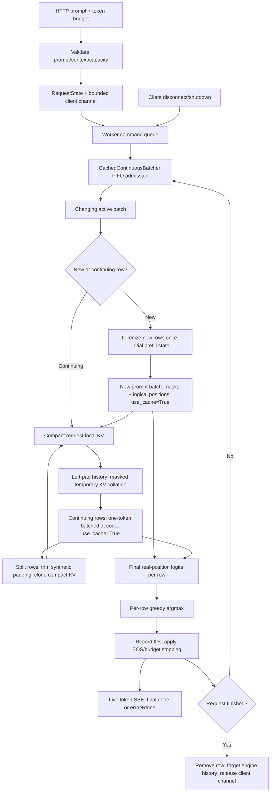
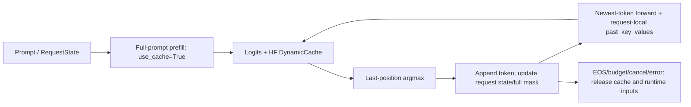

# Runtime architecture

The runtime contains several explicit execution paths, not one fully optimized engine. Transformers supplies model/attention operations; this repository supplies token loops, request state, scheduling/batching, serving ownership, capacity modeling and measurement. No path uses `model.generate()`.

## Model forward policy (Phase 3 preparation)

`model_adapter.py` preserves GPT-2 inputs and adds a focused Qwen2 policy: no
token-type embeddings, logical per-row RoPE positions, final-position logits,
and model generation-config EOS IDs. Cache collation still owns temporary
left-padding and compact request-local full-attention DynamicCache tensors.
Sliding-window Qwen caches are rejected, not silently compacted. The scheduler
and admission algorithm are unchanged. The loader accepts explicit device,
dtype, revision and attention implementation; the public app still defaults to
distilgpt2 on CPU.

This was inspected against installed Transformers 5.17.0: Qwen2's forward accepts
`position_ids` and `past_key_values`; it has no explicit `cache_position` argument.
RoPE is applied before cache insertion. A cached decode therefore uses each
row's logical history length, not the padded batch width. Tiny randomly
initialized Qwen2/GQA CPU tests exercise these mechanics; they are **not** proof
that the real Qwen2.5-0.5B checkpoint works on a T4. That execution and its exact
internal greedy parity gate remain pending the Colab run.

## HTTP data path (cached continuous greedy by default)



`CachedContinuousBatcher` partitions newcomers and continuing rows before either forward. A tick may run one prefill batch plus one decode batch, but each request selects at most one token. Newcomers join incumbent cached decode rows on subsequent ticks. Continuing model inputs are exactly `[B, 1]`, not full contexts. The selected output is excluded from stored KV until the next forward. Completion releases it immediately.

The [cache adapter design](cached-continuous-batching.md) records the inspected Transformers 5.17.0 API, padding/mask/position rules and ownership invariants. Ragged caches are copied into a padded batch, then split and cloned back into compact request-local caches. This is real KV reuse with copying overhead, not physical paging or an optimized kernel.

`create_app(engine="continuous_cached_greedy")` selects this path explicitly. `LLM_RUNTIME_ENGINE` selects it when no argument is given; the default is cached. `continuous_uncached_greedy` retains the original `ContinuousBatcher` and `batch_step(use_cache=False)` reference, where full contexts are recollated. Selection is centralized at app construction. `/health` and `/runtime/snapshot` report actual `engine` and `serving_cache`; tests inject modes explicitly. The public entrypoint still caps capacity at one row, independently of local capacity four.

`server.create_app` loads once per lifespan (or accepts model/tokenizer injection for tests). `ServingRuntime` alone owns engine commands and mutations. An async worker processes admission/cancellation commands between forwards; `asyncio.to_thread(engine.step)` keeps model work off the event loop. Only one model forward is in flight per worker. It publishes row tokens before starting the next tick. Defaults: four active rows, 64 pending clients, 128 new tokens/request, 130 events/client channel. Validation precedes streaming headers.

Disconnect cleanup enqueues cancellation, so it cannot change a row while its shared forward runs. Completion sends a small result and forgets engine history; endpoint cleanup releases its channel. Shared-forward failure sends sanitized error/done events and releases active history without terminating the worker. These limits are not a production flow-control system: token channels are buffered, with no delivery acknowledgment, durable queue, authentication or multi-worker coordination.

Health and runtime telemetry read the same published completed-worker boundary, not the inference thread's live trace. `_publish()` captures forward count and last/maximum batch sizes between forwards; `/health` takes those fields from `snapshot()`. The maximum retains the existing bounded engine-history scope (last 1,024 ticks), not an unbounded lifetime maximum. No additional lock or second ownership system is needed. Worker failures use standard exception logging with traceback while HTTP/SSE clients retain generic errors.

## Cached single-request/scheduler data path



`cached_greedy_decode` demonstrates this path directly. `DecodeScheduler` applies FIFO bounded admission and round-robin execution to independently cached requests; one step advances **one request**, not a batch. Each request owns its cache/full logical mask. In the inspected GPT-2 API, DynamicCache length supplies ordinary single-request position offsets. Cache objects may mutate in place; retain the model's returned cache rather than assuming legacy tuple layouts.

After prefill of T tokens, the cache contains the processed T-token prompt; the selected next token is not yet cached. The next forward processes that token, adding its K/V. Ten output tokens from a five-token prompt require lengths `[5,1,1,1,1,1,1,1,1,1]`: 14 processed positions. The last selected token need not be forwarded once generation finishes. Attention still reads past K/V and cache grows; caching is not constant-time or memory-free decoding.

## Prefill, decode, scheduling and batching

Prefill computes prompt hidden states and (on cached paths) K/V. Decode predicts successive continuation tokens. Uncached decode recomputes prompt and prior continuation; cached decode forwards the newest token with retained K/V.

Scheduling answers **which request can run and when**. Batching answers **which rows share one model forward**. `DecodeScheduler` is round-robin single-row cached execution. `batched_greedy_decode` uses a fixed cohort and removes completed rows. `ContinuousBatcher` additionally fills vacancies from FIFO waiting at the next tick:

```text
tick 1: waiting C     active A+B     -> A finishes
tick 2: admit C       active B+C     -> both progress
tick 3:              active B+C     -> both finish
```

Rows have different real lengths. `batch_step` left-pads so every last real token is at the last column, masks pad positions, and computes positions from cumulative masks. It uses PAD or EOS locally without mutating the tokenizer. Token IDs alone cannot distinguish real EOS from padding; padded positions must not shift meaningful GPT-2 positions.

## Request state and cleanup

```text
WAITING -> PREFILL -> DECODING -> FINISHED
                  -> FINISHED (zero-token budget / EOS / token limit)
Any unfinished state -> FINISHED (cancelled / error)
```

`RequestState` stores prompt/selected IDs, stop reason, runtime inputs, request-local cache and optional logical block IDs. `record_token` enforces state/stopping rules. `finish` clears runtime tensors/cache and the block-ID view. The allocator owner (`ContinuousBatcher`) separately returns blocks; clearing a list is not freeing pool ownership. Exported results do not serialize tensors/cache. A row's `model_execution_count` counts token-producing executions, whereas engine forward count counts shared forwards.

## HF DynamicCache versus logical block allocation

HF DynamicCache owns **actual K/V tensors** on cached paths. `BlockAllocator` owns **logical numbered capacity blocks**, never tensor addresses. Request tables map logical block order to pool IDs; IDs need not be contiguous:

```text
block size = 2 tokens; pool IDs = 0,1,2,3
A reserves 3 processed tokens -> A:[0,1] (capacity 4)
B reserves 2 processed tokens -> B:[2]   (capacity 2)
free A -> free list [3,0,1]
B grows to 5 tokens -> B:[2,3,0] (capacity 6)
free B -> all four IDs available for reuse
```

`reserve` computes ceiling(tokens/block_size), checks exhaustion before changing ownership, and appends required IDs. It does not shrink. `free` rejects double/unknown frees. Snapshots copy tables so callers cannot corrupt ownership. Internal fragmentation is unused tail capacity; noncontiguous reused IDs require no contiguous allocation in this model.

With `ContinuousBatcher(..., block_allocator=pool)`, reservation follows tokenization and precedes each forward for current processed context. Traces expose before-forward ownership and after-completion pool state. Completion/cancellation/error returns blocks, including partial cohort reservations on failure. Exhaustion fails the cohort rather than evicting/swapping/waiting for memory. HTTP leaves this optional allocator disabled. There is **no custom PagedAttention/kernel, physical paging, or change to HF DynamicCache storage**.

## Selection and optimization experiments

Greedy argmax and temperature/top-k/top-p/multinomial sampling are separate selection paths. Sampling uses an optional local seeded generator; it remains uncached and is not exposed by HTTP.

`benchmark_quantization` deep-copies the model, transposes GPT-2 affine Conv1D weights into equivalent Linear layers, checks FP32 logits, then uses native dynamic INT8 only for attention/MLP projections. Embeddings/layer norms/tied output head stay FP32. Estimated tensor payload is not backend packed memory or RSS. Output drift is retained, not treated as parity.

`speculative_greedy_decode` shares verified token-ID/BPE semantics between tiny draft and target. Both run uncached contexts. Draft K tokens; forward target on prefix plus proposals; prediction at T-1+j checks proposal j; accept the matching prefix; on mismatch emit target argmax/discard suffix; on all-match emit a permitted bonus. Only verified output advances the real prefix. No rollback is needed without caches. Benchmarks require exact ordinary-target greedy parity. This is greedy speculation, not stochastic rejection sampling.

## Measurement and code map

Local benchmark CLIs measure token selection availability; the server CLI measures network SSE arrivals and level throughput. Loading/excluded warmups do not enter request statistics. Speculative block tokens share availability timestamps. Historical M5 is not a paired denominator. `benchmark_summary` copies representative values with canonical source hashes and performs no inference.

| Concern | Files |
| --- | --- |
| Model/logits | `model_loader.py`, `forward_inspect.py` |
| Token loops | `greedy_decode.py`, `sample_decode.py`, `cached_decode.py`, `speculative_decode.py` |
| Filters | `sampling.py` |
| Execution ownership | `request.py`, `scheduler.py`, `batching.py`, `continuous_batcher.py`, `cached_continuous_batcher.py` |
| Ragged cache adapter | `cache_batch.py` |
| Logical capacity | `block_allocator.py` |
| HTTP/event ownership | `server.py` |
| Measurements/aggregation | `benchmark_*.py`, `benchmarks/results/*.json` |

Phase 2 connects continuous admission to real ragged cached storage. There is still no PagedAttention, physical block paging, custom CUDA kernel, tensor parallelism, or memory-aware eviction/swapping.

## CLI and API reference

These examples were moved from the landing page. Run from the repository root after installing `.[server,test]`; use a new scratch output path for measurements. Model commands use the Hugging Face cache outside this repository. All CLI modules support `--help` without loading weights.

```powershell
python -m llm_runtime.model_loader distilgpt2 --device cpu
python -m llm_runtime.forward_inspect --device cpu --prompt "The capital of France is"
python -m llm_runtime.greedy_decode --device cpu --max-new-tokens 10
python -m llm_runtime.sample_decode --device cpu --temperature 0.8 --top-k 40 --top-p 0.95 --seed 42 --max-new-tokens 10
python -m llm_runtime.cached_decode --device cpu --max-new-tokens 10
python -m llm_runtime.speculative_decode --device cpu --max-new-tokens 10 --draft-tokens 3
```

Forward inspection reports token pieces/IDs, tensor shapes, logits and final-position candidates without generating a continuation. Sampling applies temperature → top-k → top-p → softmax → multinomial. Temperature must be positive/finite (use greedy rather than zero). Top-k retains exactly k candidates, clamped to vocabulary; top-p retains the threshold-crossing token. A seed initializes a local device-specific generator, not global randomness; cross-version/device reproducibility is not promised.

| Local endpoint | Behavior |
| --- | --- |
| `GET /health` | Model/device/capacity and published forward/batch counters |
| `GET /runtime/snapshot` | Bounded completed-boundary traces and request summaries |
| `POST /generate` | Final IDs/text/stop reason |
| `POST /generate/stream` | Live SSE `token` then `done`; failure emits `error` then `done` |

Request JSON accepts only `prompt` (non-whitespace, up to 4,096 characters) and `max_new_tokens` (0–128, default 10). Context budget is checked before streaming headers. Sampling fields and unknown fields are rejected. This API is greedy-only (cached by default) and is not OpenAI-compatible. Zero-token streams emit only `done`, with no forward or TTFT. Token events contain IDs, individual text and the decoded generated prefix; use the prefix/final text for Unicode safety because token fragments need not concatenate correctly.

```powershell
$body = @{prompt="The capital of France is"; max_new_tokens=4} | ConvertTo-Json -Compress
Invoke-RestMethod http://127.0.0.1:8765/health
Invoke-RestMethod http://127.0.0.1:8765/generate -Method Post -ContentType "application/json" -Body $body
$body | curl.exe -N http://127.0.0.1:8765/generate/stream -H "Content-Type: application/json" --data-binary "@-"
```

Historical benchmark reproduction commands (keep new measurements separate from committed results):

```powershell
python -m llm_runtime.benchmark_naive --device cpu --max-new-tokens 10 --warmup-runs 1 --runs 3 --output benchmark_results/naive.json
python -m llm_runtime.benchmark_cache --device cpu --max-new-tokens 10 --warmup-runs 1 --runs 3 --output benchmark_results/cache.json
python -m llm_runtime.benchmark_quantization --max-new-tokens 10 --warmup-runs 1 --runs 3 --output benchmark_results/quantization.json
python -m llm_runtime.benchmark_speculative --max-new-tokens 10 --draft-tokens 3 --warmup-runs 1 --runs 3 --output benchmark_results/speculative.json
# With the local server already running:
python -m llm_runtime.benchmark_server --url http://127.0.0.1:8765 --concurrency 1 2 4 --requests 16 --max-new-tokens 4 --warmup-runs 1 --output benchmark_results/serving.json
python -m llm_runtime.benchmark_summary
```

Base dependencies are torch and transformers; test extras add pytest/HTTPX and server extras add FastAPI/Uvicorn/HTTPX. Bounds are not a lockfile. First model load can take time/disk space; successful unauthenticated-Hub or Windows symlink warnings do not imply an inference error. Existing Starlette/HTTPX and quantization deprecation warnings remain visible. See the [UI guide](portfolio-ui.md) for frontend versions and [postmortem](postmortem.md) for experimental tradeoffs.
