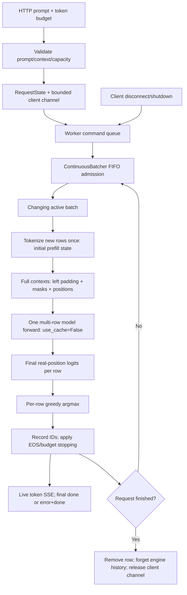
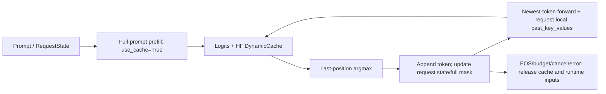

# Runtime architecture

The runtime contains several explicit execution paths, not one fully optimized engine. Transformers supplies model/attention operations; this repository supplies token loops, request state, scheduling/batching, serving ownership, capacity modeling and measurement. No path uses `model.generate()`.

## HTTP data path (currently uncached)



There is deliberately **no KV-cache node between this HTTP model and logits**: `batch_step` passes `use_cache=False`. A mixed active batch can contain a newly admitted prefill row and continuing decode rows, but continuing rows still recompute their complete contexts. Adding a cached box to this diagram would misrepresent the implemented backend.

`server.create_app` loads once per lifespan (or accepts model/tokenizer injection for tests). `ServingRuntime` alone owns engine commands and mutations. An async worker processes admission/cancellation commands between forwards; `asyncio.to_thread(engine.step)` keeps model work off the event loop. Only one model forward is in flight per worker. It publishes row tokens before starting the next tick. Defaults: four active rows, 64 pending clients, 128 new tokens/request, 130 events/client channel. Validation precedes streaming headers.

Disconnect cleanup enqueues cancellation, so it cannot change a row while its shared forward runs. Completion sends a small result and forgets engine history; endpoint cleanup releases its channel. Shared-forward failure sends sanitized error/done events and releases active history without terminating the worker. These limits are not a production flow-control system: token channels are buffered, with no delivery acknowledgment, durable queue, authentication or multi-worker coordination.

## Cached single-request/scheduler data path



`cached_greedy_decode` demonstrates this path directly. `DecodeScheduler` applies FIFO bounded admission and round-robin execution to independently cached requests; one step advances **one request**, not a batch. Each request owns its cache/full logical mask. In the inspected GPT-2 API, DynamicCache length supplies ordinary single-request position offsets. Cache objects may mutate in place; retain the model's returned cache rather than assuming legacy tuple layouts.

After prefill of T tokens, the cache contains the processed T-token prompt; the selected next token is not yet cached. The next forward processes that token, adding its K/V. Ten output tokens from a five-token prompt require lengths `[5,1,1,1,1,1,1,1,1,1]`: 14 processed positions. The last selected token need not be forwarded once generation finishes. Attention still reads past K/V and cache grows; caching is not constant-time or memory-free decoding.

## Prefill, decode, scheduling and batching

Prefill computes prompt hidden states and (on cached paths) K/V. Decode predicts successive continuation tokens. Uncached decode recomputes prompt and prior continuation; cached decode forwards the newest token with retained K/V.

Scheduling answers **which request can run and when**. Batching answers **which rows share one model forward**. `DecodeScheduler` is round-robin single-row cached execution. `batched_greedy_decode` uses a fixed cohort and removes completed rows. `ContinuousBatcher` additionally fills vacancies from FIFO waiting at the next tick:

```text
tick 1: waiting C     active A+B     -> A finishes
tick 2: admit C       active B+C     -> both progress
tick 3:              active B+C     -> both finish
```

Rows have different real lengths. `batch_step` left-pads so every last real token is at the last column, masks pad positions, and computes positions from cumulative masks. It uses PAD or EOS locally without mutating the tokenizer. Token IDs alone cannot distinguish real EOS from padding; padded positions must not shift meaningful GPT-2 positions.

## Request state and cleanup

```text
WAITING -> PREFILL -> DECODING -> FINISHED
                  -> FINISHED (zero-token budget / EOS / token limit)
Any unfinished state -> FINISHED (cancelled / error)
```

`RequestState` stores prompt/selected IDs, stop reason, runtime inputs, request-local cache and optional logical block IDs. `record_token` enforces state/stopping rules. `finish` clears runtime tensors/cache and the block-ID view. The allocator owner (`ContinuousBatcher`) separately returns blocks; clearing a list is not freeing pool ownership. Exported results do not serialize tensors/cache. A row's `model_execution_count` counts token-producing executions, whereas engine forward count counts shared forwards.

## HF DynamicCache versus logical block allocation

HF DynamicCache owns **actual K/V tensors** on cached paths. `BlockAllocator` owns **logical numbered capacity blocks**, never tensor addresses. Request tables map logical block order to pool IDs; IDs need not be contiguous:

```text
block size = 2 tokens; pool IDs = 0,1,2,3
A reserves 3 processed tokens -> A:[0,1] (capacity 4)
B reserves 2 processed tokens -> B:[2]   (capacity 2)
free A -> free list [3,0,1]
B grows to 5 tokens -> B:[2,3,0] (capacity 6)
free B -> all four IDs available for reuse
```

`reserve` computes ceiling(tokens/block_size), checks exhaustion before changing ownership, and appends required IDs. It does not shrink. `free` rejects double/unknown frees. Snapshots copy tables so callers cannot corrupt ownership. Internal fragmentation is unused tail capacity; noncontiguous reused IDs require no contiguous allocation in this model.

With `ContinuousBatcher(..., block_allocator=pool)`, reservation follows tokenization and precedes each forward for current processed context. Traces expose before-forward ownership and after-completion pool state. Completion/cancellation/error returns blocks, including partial cohort reservations on failure. Exhaustion fails the cohort rather than evicting/swapping/waiting for memory. HTTP leaves this optional allocator disabled. There is **no custom PagedAttention/kernel, physical paging, or change to HF DynamicCache storage**.

## Selection and optimization experiments

Greedy argmax and temperature/top-k/top-p/multinomial sampling are separate selection paths. Sampling uses an optional local seeded generator; it remains uncached and is not exposed by HTTP.

`benchmark_quantization` deep-copies the model, transposes GPT-2 affine Conv1D weights into equivalent Linear layers, checks FP32 logits, then uses native dynamic INT8 only for attention/MLP projections. Embeddings/layer norms/tied output head stay FP32. Estimated tensor payload is not backend packed memory or RSS. Output drift is retained, not treated as parity.

`speculative_greedy_decode` shares verified token-ID/BPE semantics between tiny draft and target. Both run uncached contexts. Draft K tokens; forward target on prefix plus proposals; prediction at T-1+j checks proposal j; accept the matching prefix; on mismatch emit target argmax/discard suffix; on all-match emit a permitted bonus. Only verified output advances the real prefix. No rollback is needed without caches. Benchmarks require exact ordinary-target greedy parity. This is greedy speculation, not stochastic rejection sampling.

## Measurement and code map

Local benchmark CLIs measure token selection availability; the server CLI measures network SSE arrivals and level throughput. Loading/excluded warmups do not enter request statistics. Speculative block tokens share availability timestamps. Historical M5 is not a paired denominator. `benchmark_summary` copies representative values with canonical source hashes and performs no inference.

| Concern | Files |
| --- | --- |
| Model/logits | `model_loader.py`, `forward_inspect.py` |
| Token loops | `greedy_decode.py`, `sample_decode.py`, `cached_decode.py`, `speculative_decode.py` |
| Filters | `sampling.py` |
| Execution ownership | `request.py`, `scheduler.py`, `batching.py`, `continuous_batcher.py` |
| Logical capacity | `block_allocator.py` |
| HTTP/event ownership | `server.py` |
| Measurements/aggregation | `benchmark_*.py`, `benchmarks/results/*.json` |

Connecting uncached batching to real ragged cached storage requires another design/correctness milestone, not a documentation rename.
